# Práctica 2.2 - ASIR2 - ASGBD: Versiones de las bases de datos

## Versiones de las bases de datos
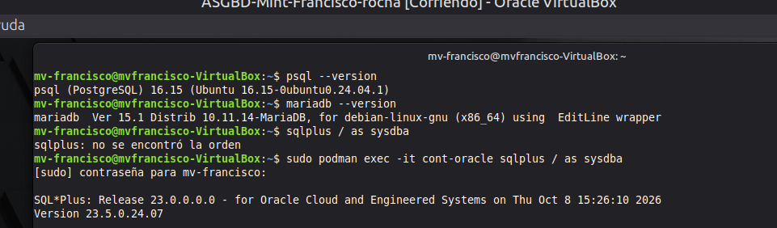

---

## 1. Desplegar Oracle Database 23ai Free con Podman

### Configuración de la máquina virtual
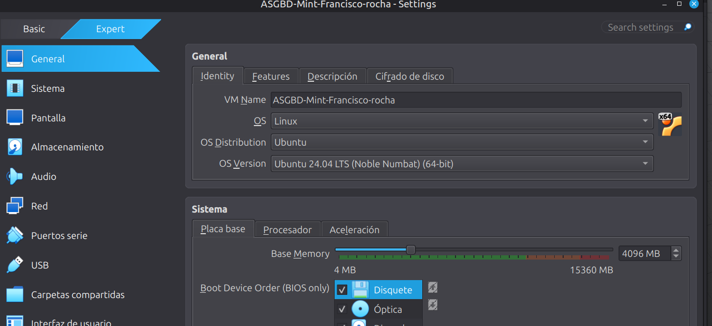  
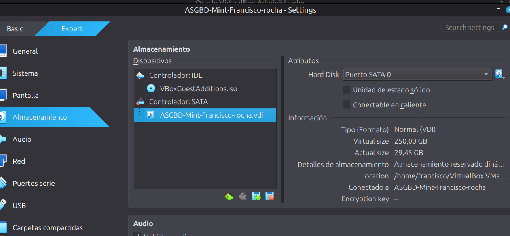

### 1.1 Preparar Podman y descargar la imagen
Actualizamos los repositorios del sistema operativo e instalamos el motor de contenedores Podman para bajar la imagen oficial de Oracle:

```bash
sudo apt update
```
  

```bash
sudo apt install podman
```
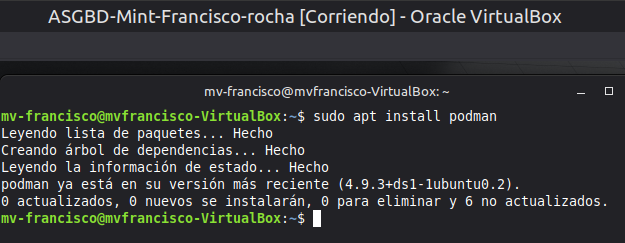  

```bash
sudo podman pull container-registry.oracle.com/database/free:23.5.0.0
sudo podman images
```
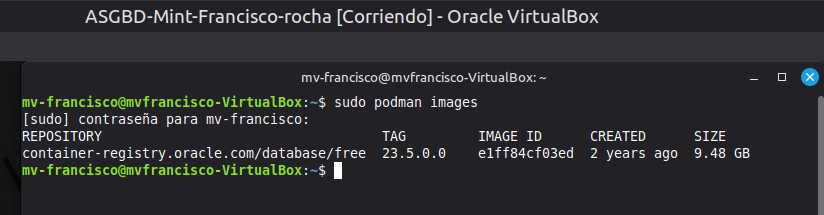  

### 1.2 Crear y comprobar el contenedor
Creamos un volumen persistente para los datos y levantamos el contenedor mapeando el puerto por defecto de Oracle (`1521`):

```bash
sudo podman volume create oracle_23ai_datos
```
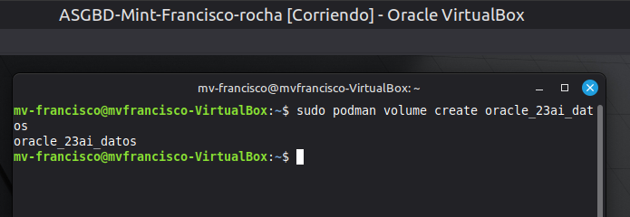  

```bash
sudo podman run -d --name cont-oracle -p 1521:1521 --restart=always -v oracle_23ai_datos:/opt/oracle/oradata:U container-registry.oracle.com/database/free:23.5.0.0
```
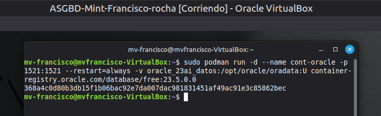  

```bash
sudo podman ps
```
  

```bash
sudo podman ps -a
```
  

```bash
sudo podman logs cont-oracle
```
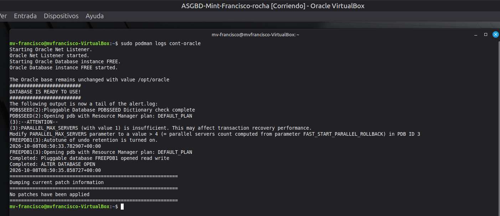  

### 1.3 Entrar en Oracle y crear el usuario de trabajo
Accedemos al contenedor interactivo y entramos mediante `sqlplus` para configurar nuestro espacio de trabajo:

```bash
sudo podman exec -it cont-oracle /bin/bash
```
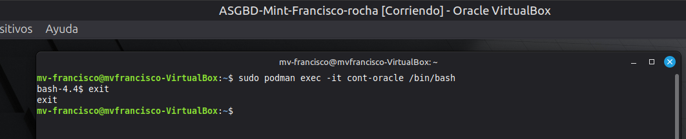  

```bash
sudo podman exec -it cont-oracle sqlplus / as sysdba
```
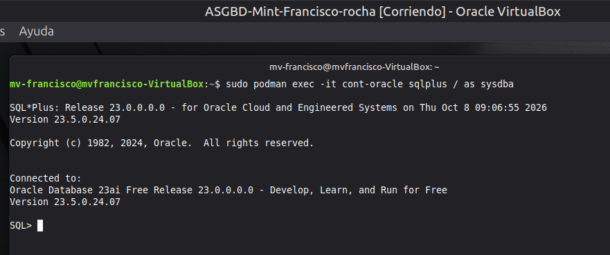  

```sql
ALTER SESSION SET CONTAINER = FREEPDB1;
CREATE USER orauser IDENTIFIED BY "TU_CLAVE";
GRANT CREATE SESSION, CREATE TABLE TO orauser;
ALTER USER orauser QUOTA 100M ON USERS;
EXIT;
```
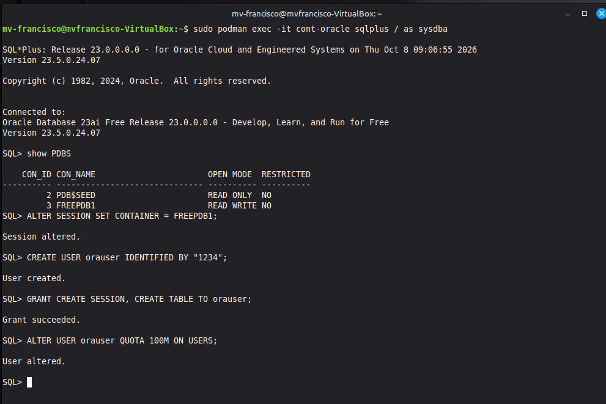  

Comprobamos que la conexión local funciona correctamente con el nuevo usuario:
```bash
sudo podman exec -it cont-oracle sqlplus orauser@//localhost:1521/FREEPDB1
```
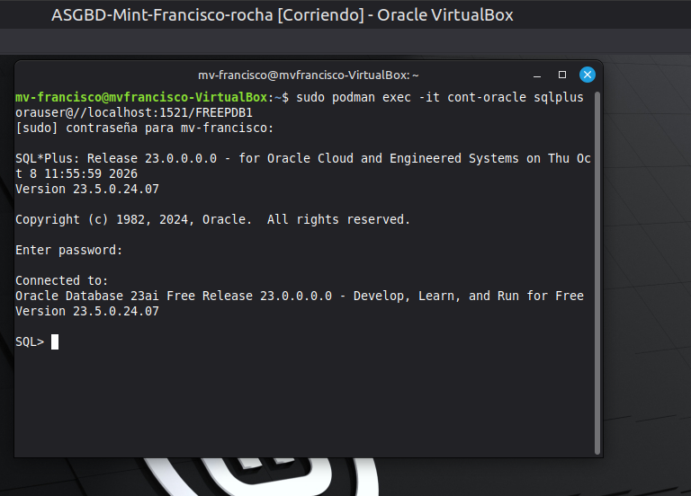  

---

## 2. Desplegar PostgreSQL

Instalamos los paquetes necesarios para PostgreSQL y su extensión de PHP, habilitamos el servicio en el sistema y configuramos la base de datos inicial:

```bash
sudo apt install postgresql postgresql-contrib php-pgsql
```
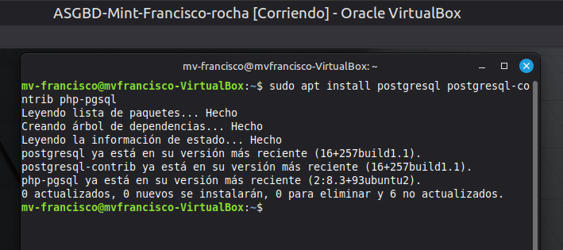  

```bash
sudo systemctl start postgresql
```
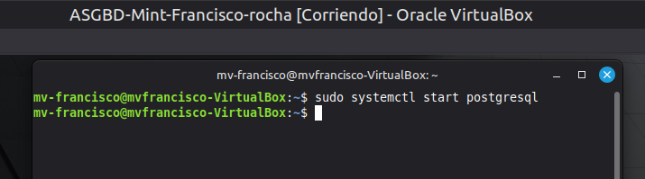  

```bash
sudo systemctl enable postgresql
```
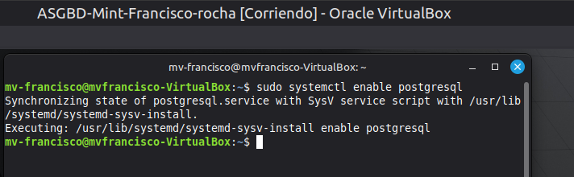  

Entramos con el usuario del sistema `postgres` de forma interactiva a la consola de administración (`psql`):
```bash
sudo -i -u postgres
```
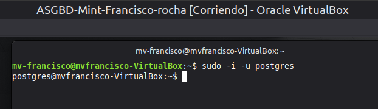  

```bash
psql
```
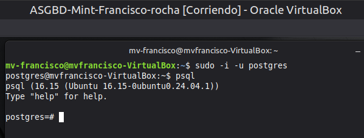  

```sql
CREATE DATABASE dbpg;
CREATE USER pguser WITH PASSWORD 'TU_CLAVE';
GRANT ALL PRIVILEGES ON DATABASE dbpg TO pguser;
\q
```
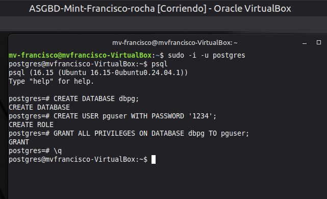  

Verificamos el acceso local usando el nuevo usuario y base de datos creados:
```bash
psql -h localhost -U pguser -d dbpg -W
```
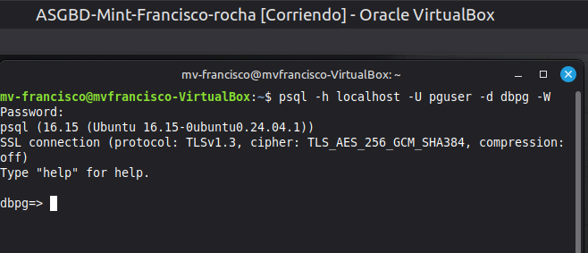  

---

## 3. Desplegar MariaDB

Instalamos el servidor y cliente de MariaDB, arrancamos el entorno y accedemos como administrador del motor relacional:

```bash
sudo apt install mariadb-server mariadb-client
```
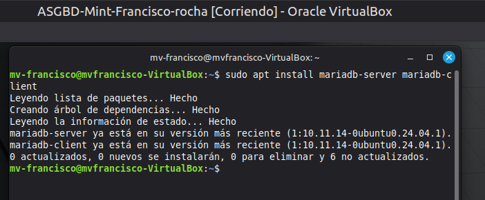  

```bash
sudo systemctl enable --now mariadb
```
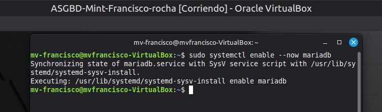  

```bash
sudo mariadb
```
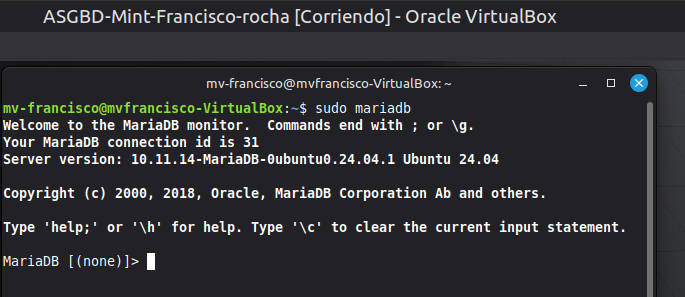  

```sql
CREATE DATABASE dbm CHARACTER SET utf8mb4 COLLATE utf8mb4_unicode_ci;
CREATE USER 'muser'@'localhost' IDENTIFIED BY 'TU_CLAVE';
GRANT ALL PRIVILEGES ON dbm.* TO 'muser'@'localhost';
FLUSH PRIVILEGES;
EXIT;
```
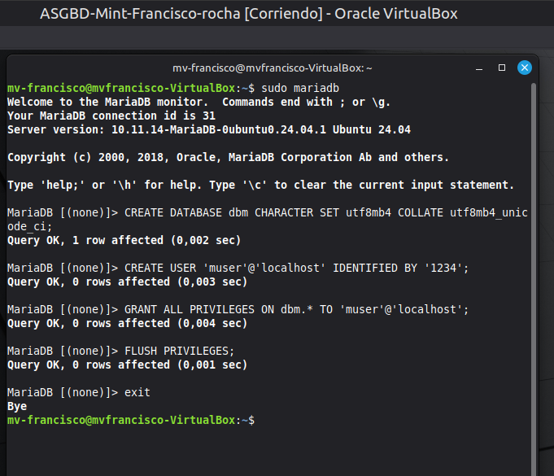  

Probamos el acceso local de forma ordinaria:
```bash
mariadb -u muser -p dbm
```
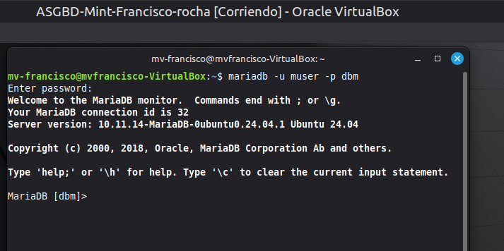  

---

## 4. Conexiones desde otra máquina

A continuación, se detalla la configuración requerida en los archivos de los servicios para admitir peticiones procedentes de direcciones IP de la red externa.

### PostgreSQL
Modificamos el archivo de configuración `postgresql.conf` para escuchar la IP de la interfaz:
```text
listen_addresses = 'IP_DE_LA_VM'
```
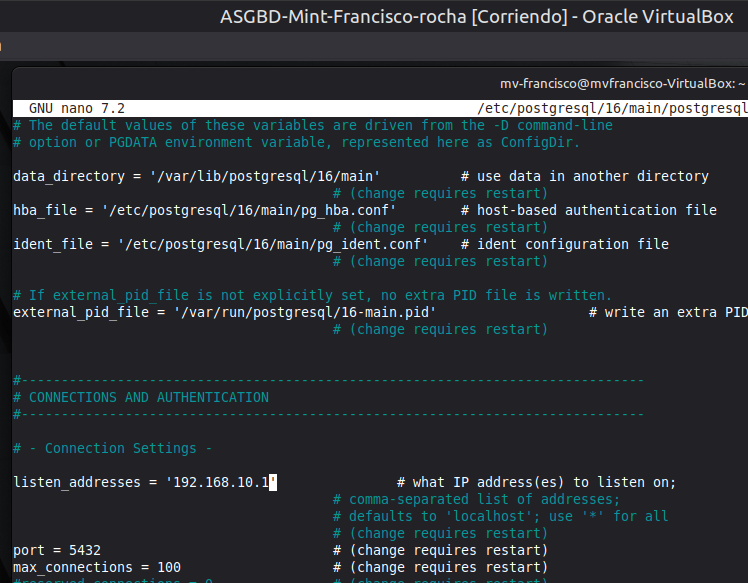  

Editamos el fichero `pg_hba.conf` para permitir el acceso a la subred del cliente:
```text
host dbpg pguser 192.168.1.0/24 scram-sha-256
```
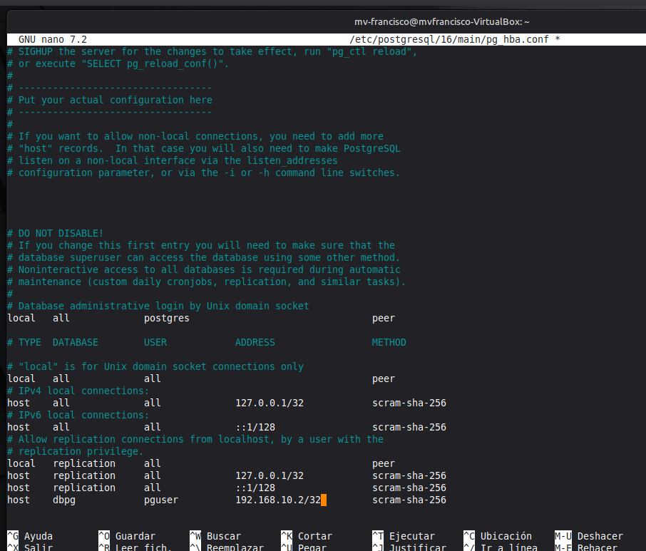  

Reiniciamos el servicio de PostgreSQL para aplicar los cambios:
```bash
sudo systemctl restart postgresql
```
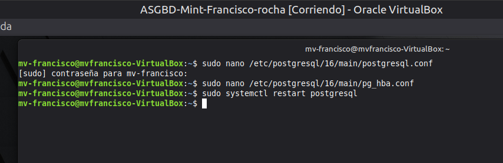  

Comprobamos la conectividad remota desde el equipo cliente:
```bash
psql -h IP_DE_LA_VM -U pguser -d dbpg -W
```
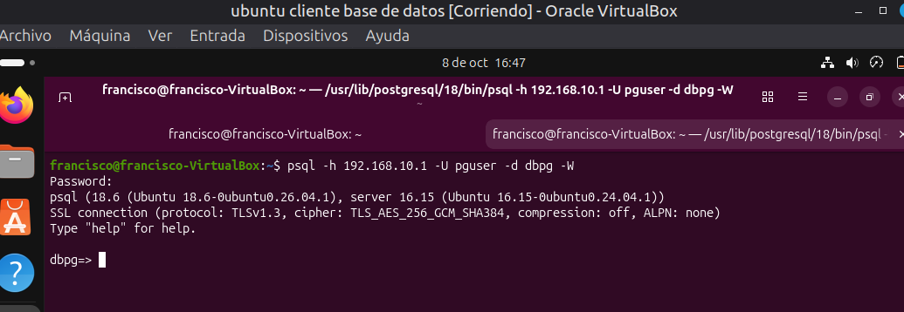  

### MariaDB
Editamos el archivo de configuración de MariaDB (`50-server.cnf` o similar) para cambiar la directiva de escucha de red:
```text
bind-address = IP_DE_LA_VM
```
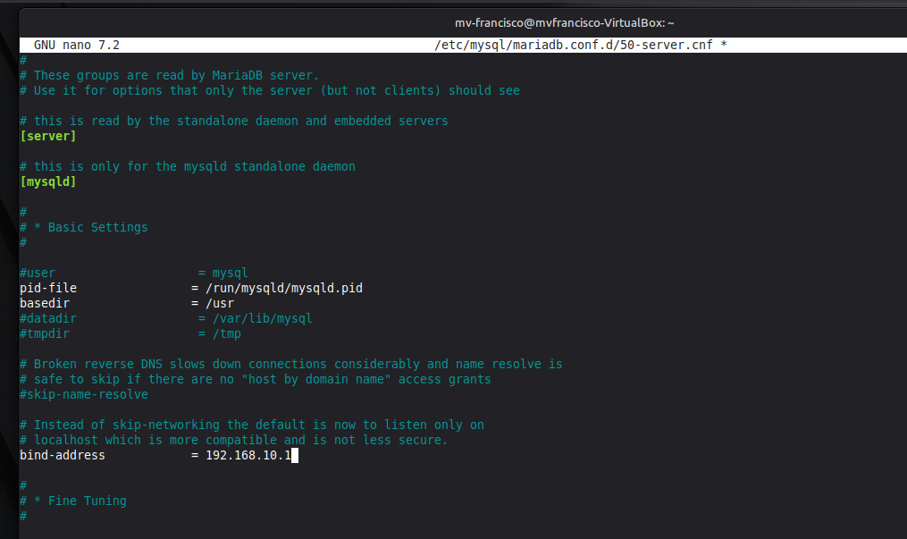  

Damos de alta los privilegios explícitos para el origen de red del cliente dentro de la base de datos:
```sql
CREATE USER 'muser'@'IP_DEL_CLIENTE' IDENTIFIED BY 'TU_CLAVE';
GRANT ALL PRIVILEGES ON dbm.* TO 'muser'@'IP_DEL_CLIENTE';
FLUSH PRIVILEGES;
EXIT;
```
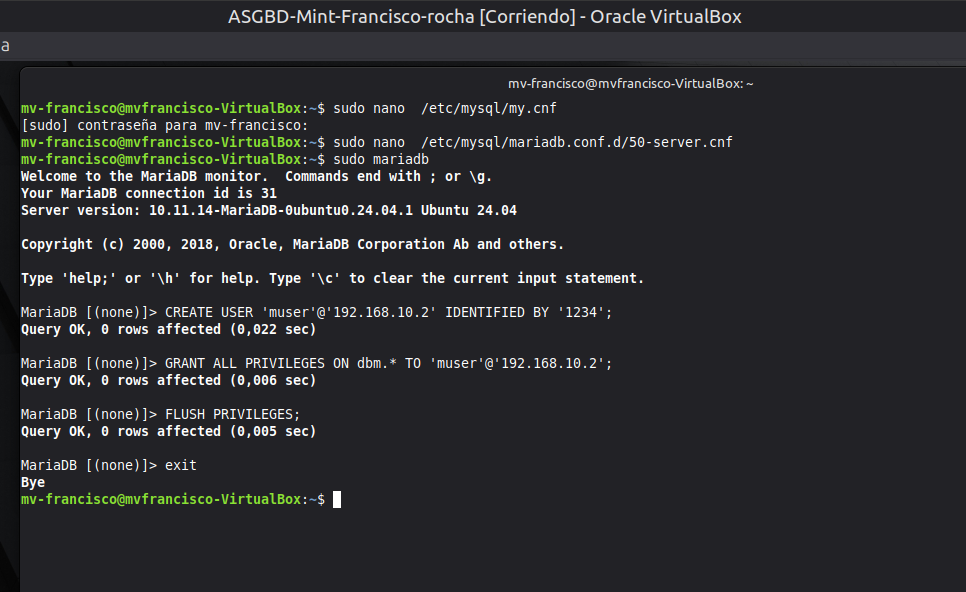  

Reiniciamos el servicio de MariaDB:
```bash
sudo systemctl restart mariadb
```
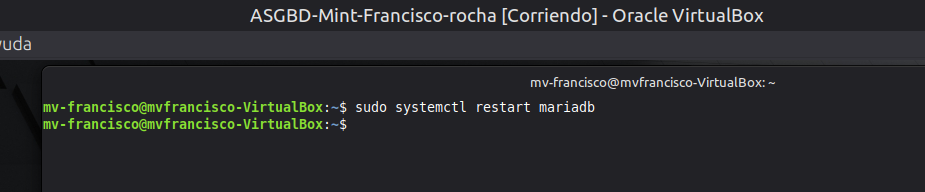  

Validamos el acceso remoto desde la máquina externa:
```bash
mariadb -h IP_DE_LA_VM -u muser -p dbm
```
  

### Oracle 23ai Free
Comprobamos que se puede conectar:

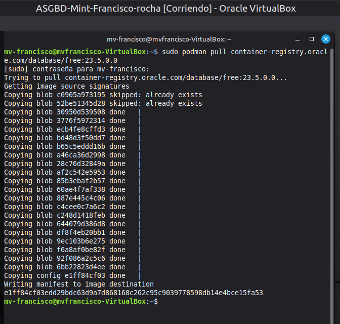

fuentes consultadas:

https://informatica.iesalbarregas.com/pluginfile.php/15191/mod_assign/introattachment/0/Practica_Instalar_3_SGBD.pdf?forcedownload=1

Incidencia:
No encontre problemas
